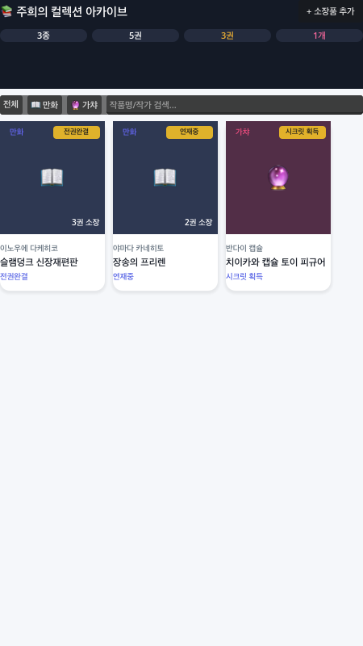
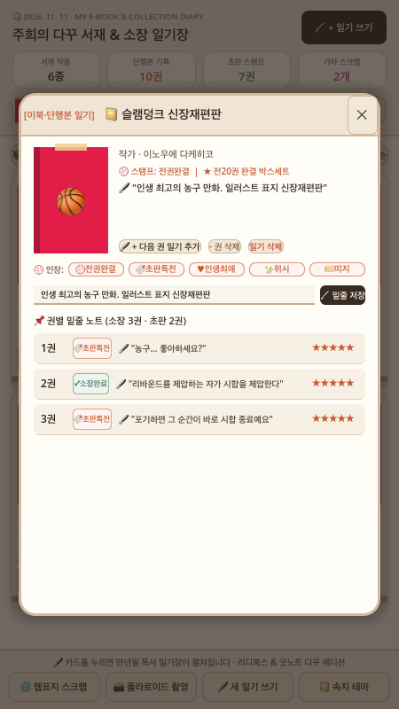
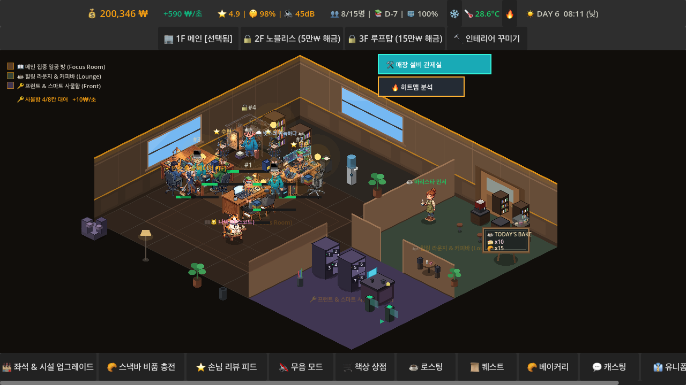
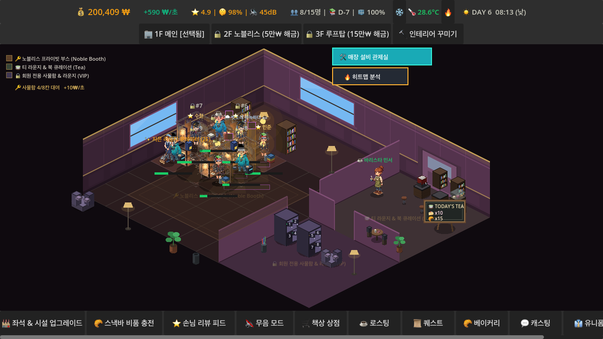
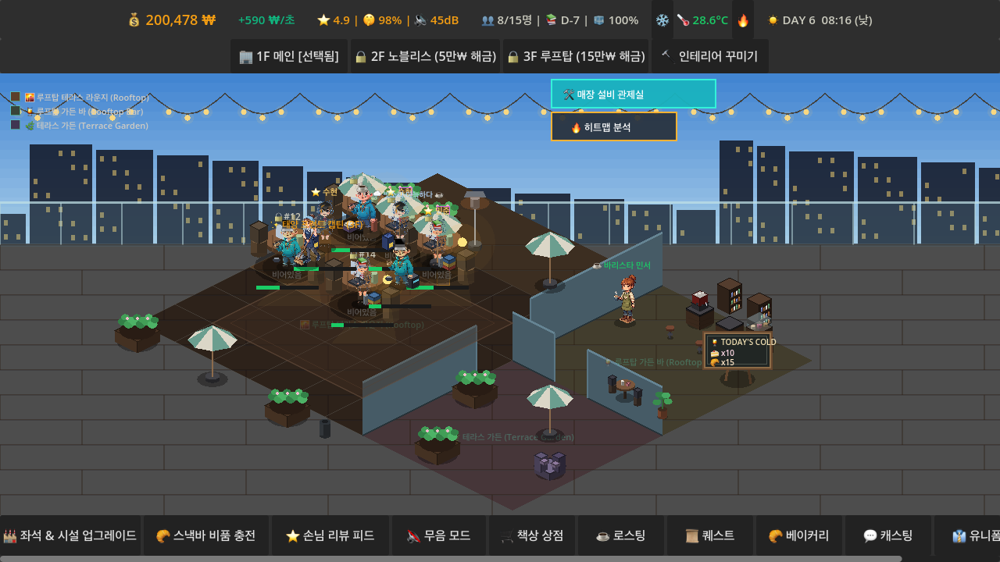
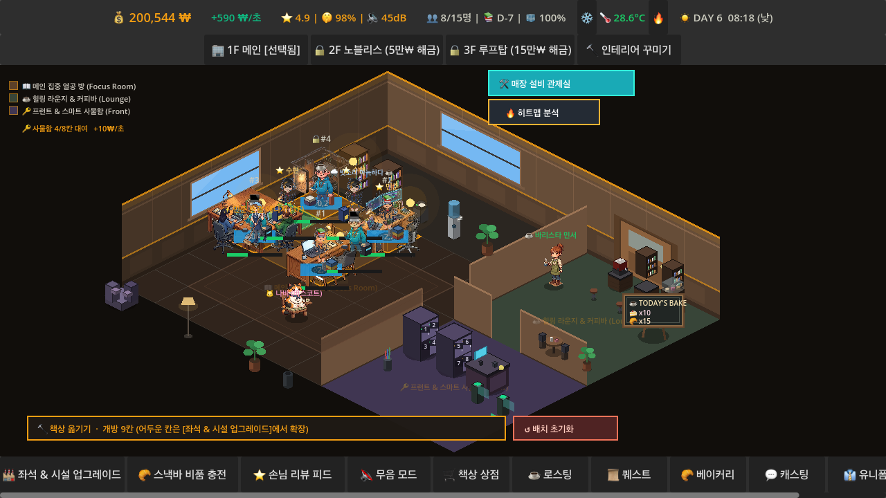

# 🎮 Log404 Studio — Multi-Project Workspace

Godot 4+ 기반의 감성 게임 및 인터랙티브 아카이브 애플리케이션 프로젝트 모음입니다.

---

## 🗂️ 프로젝트 라인업 (Projects)

| 프로젝트 | 장르 & 플랫폼 | 설명 | 주요 기술 및 문서 |
| :--- | :--- | :--- | :--- |
| **[Game02] 주희의 다꾸 서재 & 소장 일기장** | 📔 E-Book 서재 & 만년필 다꾸 독서노트 (Mobile) | 리디북스·Apple Books 감성 서재 + 굿노트·몰스킨 다이어리 | [Game02 상세 문서](game02/README.md) · [스프린트 회의록](game02/SPRINT_LOG.md) |
| **[Game01] 스터디 카페 타이쿤** | ☕ 2.5D 이소메트릭 경영 시뮬레이션 (PC/iOS) | 수험생과 카공족을 유치하는 프리미엄 스터디 카페 타이쿤 | [Game01 상세 보기](#-game01-스터디-카페-타이쿤-study-cafe-tycoon) |

---

## 📔 [Game02] 주희의 다꾸 서재 & 소장 일기장 (Pocket Archive)

> **Godot 4.6.2 모바일 기반 E-Book 리더기 서재(Apple Books · 리디북스) & 만년필 다꾸 독서노트(굿노트 · 몰스킨) 감성 아카이브 앱**  
> 14인 가상 애자일 스쿼드가 20분 주기 자동 스프린트로 지속 개선 중입니다.

### 📸 실제 구동 스크린샷 (Godot 4.6 Metal 렌더링 — Sprint 20)

| 📔 메인 E-Book 서재 & 다꾸 일기장 (`main.tscn`) | 🖋️ 펼친 몰스킨 독서노트 상세 모달 (`detail_modal.tscn`) |
| :---: | :---: |
|  |  |

### ✨ 주요 핵심 기능
- **E-Book 서재 & 미니 책등 선반(`SpineShelfRow`)**: 소장 권수 두께와 표지 컬러를 반영한 미니 책등 선반 및 금박 책갈피 팁
- **서재 전체 완독률 실시간 게이지 & 오늘의 밑줄 배너**: 소장 도서 전체의 독서율(`서재 완독률 81%`) 동적 표시 및 명대사 다이렉트 점프
- **독서 진행률 프로그레스 바(`ReadingProgressBar`)**: 리디북스 감성의 미색 종이 & 테라코타 오렌지 완독률(%) 트래커
- **나만의 다꾸 독서 일기장(`DetailModal`)**: 펼친 몰스킨 2페이지 뷰, 권별 읽은 날짜 스탬프(`📅 11.12`), 인장 도장(`💮전권완결`, `🔖초판특전`, `♥인생최애`, `✨위시`), 권별 명대사 밑줄 편집, 별점 변경
- **랜덤 추천 뽑기 & 완독작 필터**: 오늘 읽을 책을 무작위로 뽑아주는 `🎲 추천` 및 완독작 100% 모아보기 탭
- **100% 로컬 영구 저장 & 웹 목업**: `user://archive_data_v2.json` 영구 보존 및 브라우저 인터랙티브 목업(`game02/index.html`)

### 🧪 Game02 헤드리스 자동화 테스트 실행 (100% PASS)
```bash
godot --headless --path game02/godot_project -s tests/test_archive.gd
godot --headless --path game02/godot_project -s tests/test_persistence.gd
godot --headless --path game02/godot_project -s tests/test_main_integration.gd
```

---

## ☕ [Game01] 스터디 카페 타이쿤 (Study Cafe Tycoon)

> **Godot 4 기반 2.5D 이소메트릭 방치형/경영 시뮬레이션 멀티플랫폼 타이쿤 게임**  
> 개발: Log404 Studio | 엔진: Godot Engine v4.6+ (GDScript)

### 📸 2.5D 비주얼 스크린샷 (Visual Showcase)

| 1층 메인 집중 열공 방 (Focus Room) | 2층 귀족 노블 부스 존 (Noble Booth) |
| :---: | :---: |
|  |  |

| 3층 루프탑 테라스 라운지 (Rooftop Terrace) | 2.5D 마그네틱 자석 그리드 배치 모드 |
| :---: | :---: |
|  |  |

### 🔥 Game01 핵심 시스템
- **다중 구역 통합 건축 구조**: 메인 집중 열공 방, 힐링 라운지 & 커피 바, 프런트 & 스마트 사물함
- **실시간 2.5D 날씨 & 조명 쉐이더**: 4종 날씨 사이클(☀️ 맑음, 🌧️ 빗소리, ❄️ 눈, ☁️ 구름) 및 학생 감성 말풍선 인터랙션
- **인터랙티브 2.5D 마그네틱 그리드 배치**: 110px x 75px 그리드 자석 스냅 및 90도 회전 배치 지원
- **42개 첨단 기술 서브시스템**: 퀀텀 반물질 에너지, 텔레파시 시냅스 다운로드, 3D 홀로그램 AI 튜터, 퀀텀 블록체인 정산

### 🛠️ Game01 실행 및 테스트 방법
```bash
# Godot 4 로컬 실행
godot --path game01

# 82개 모듈 자동 검증 스위트 (Headless Mode - 100% PASS)
godot --headless --path game01 --script scripts/tests/test_all_70_modules.gd
```

---

## 📁 전체 프로젝트 폴더 구조

```text
Log404/
├── README.md                         # 전체 프로젝트 메인 안내 문서
├── game01/                           # [Game01] 2.5D 스터디 카페 타이쿤
│   ├── assets/                       # 게임 스프라이트 및 UI 자산
│   ├── build/ios/                    # iOS 네이티브 임베디드 배포 패키지 (data.pck)
│   ├── docs/                         # 모듈별 기능 사양서 (MEETING_MODULE_1~53.md)
│   ├── scenes/                       # 메인 씬 및 UI 팝업 TSCN
│   ├── scripts/                      # 게임 로직, Autoload 및 테스트 스크립트
│   └── project.godot                 # Godot 4 프로젝트 설정 파일
└── game02/                           # [Game02] 주희의 다꾸 서재 & 소장 일기장
    ├── index.html                    # 웹 인터랙티브 다꾸 서재 목업 (Tailwind + FontAwesome)
    ├── README.md                     # Game02 전용 상세 설명서
    ├── SPRINT_LOG.md                 # 14인 애자일 스쿼드 누적 스프린트 회의록 (Sprint 1~19)
    └── godot_project/                # Godot 4.6.2 네이티브 모바일 프로젝트
        ├── scenes/                   # main.tscn, card_item.tscn, detail_modal.tscn 등
        ├── scripts/                  # main_view.gd, card_item.gd, archive_state.gd 등
        ├── screenshots/              # Metal 렌더링 최신 구동 스크린샷 2종
        └── tests/                    # 헤드리스 TDD 테스트 스위트 및 스크린샷 렌더러
```
