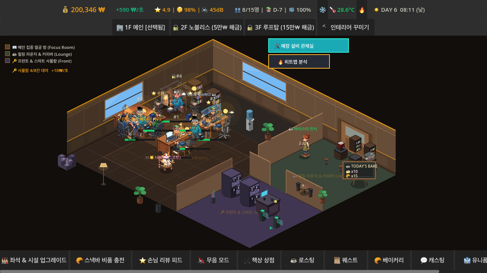
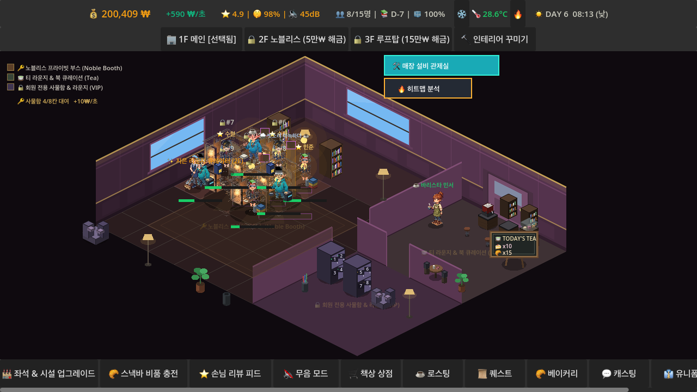
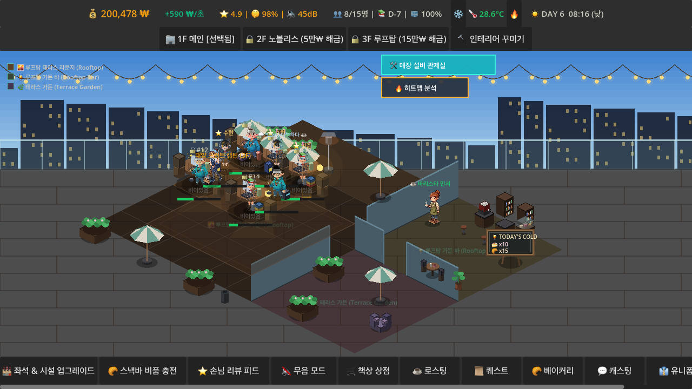
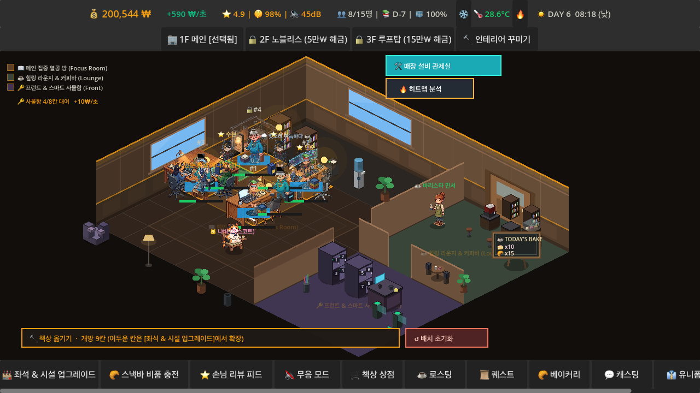

# 🎮 Log404 Studio — Multi-Project Workspace

Godot 4+ 기반의 감성 게임 및 인터랙티브 아카이브 애플리케이션 프로젝트 모음입니다.

---

## 🗂️ 프로젝트 라인업 (Projects)

| 프로젝트 | 장르 & 플랫폼 | 설명 | 주요 기술 및 문서 |
| :--- | :--- | :--- | :--- |
| **[Game02] 주희의 다꾸 서재 & 소장 일기장** | 📔 E-Book 서재 & 만년필 다꾸 독서노트 (Mobile) | 리디북스·Apple Books 감성 서재 + 굿노트·몰스킨 다이어리 | [Game02 상세 문서](game02/README.md) · [스프린트 회의록](game02/SPRINT_LOG.md) |
| **[Game01] 스터디 카페 타이쿤** | ☕ 2.5D 이소메트릭 경영 시뮬레이션 (PC/iOS) | 수험생과 카공족을 유치하는 프리미엄 스터디 카페 타이쿤 | [Game01 상세 보기](#-game01-스터디-카페-타이쿤-study-cafe-tycoon) |

---

## 📔 [Game02] 주희의 다꾸 서재 & 소장 일기장 (Pocket Archive)

> **Godot 4.6.2 모바일 기반 E-Book 리더기 서재(Apple Books · 리디북스) & 만년필 다꾸 독서노트(굿노트 · 몰스킨) 감성 아카이브 앱**  
> 14인 가상 애자일 스쿼드가 20분 주기 자동 스프린트로 지속 개선 중입니다.

### 📸 실제 구동 스크린샷 (Godot 4.6 Metal 렌더링 — Sprint 195 Milestone)

| 📔 메인 E-Book 서재 & 다꾸 일기장 (`main.tscn`) | 🖋️ 펼친 몰스킨 독서노트 상세 모달 (`detail_modal.tscn`) |
| :---: | :---: |
|  |  |

### ✨ 주요 핵심 기능
- **최신 Sprint 195 Milestone 하이라이트**: `AddModal` `H/?` 단축키 치트시트(`Shift`: 복사) · 단독 `Enter` 등록 제출(`add_modal.gd` · `main_view.gd` · `index.html`) 완성
- **Sprint 194 하이라이트**: `AddModal` 키보드 `0` 기본값 리셋 · `Home/End` 첫·끝 컬러 점프 · `Backspace` 초기화(`add_modal.gd` · `index.html`) 완성
- **Sprint 193 하이라이트**: `AddModal` 키보드 `A/Q` 작가·밑줄 포커스 · `Space` 컬러 순환 · `R` 랜덤 표지 컬러(`add_modal.gd` · `index.html`) 완성
- **Sprint 192 하이라이트**: `AddModal` 키보드 `E/G` 카테고리 직접 선택 · `T` 제목 포커스 · `S` 등록 제출(`add_modal.gd` · `index.html`) 완성
- **Sprint 191 하이라이트**: `AddModal` 키보드 `F` 샘플 채움 · `X` 입력 초기화(`Shift`: 닫기) · `←/→` 표지 컬러 순환(`add_modal.gd` · `index.html`) 완성
- **Sprint 190 Milestone 하이라이트**: 메인 키보드 `Enter` 열기(`Shift`: 새 일기 모달) · `Backspace` 초기화(`Shift`: 스튜디오 리셋) 및 치트시트(`H`) 동기화(`main_view.gd` · `index.html`) 완성
- **Sprint 189 하이라이트**: 메인 키보드 `↑/↓` 정렬·사운드 순환 · `PageUp/PageDown` 필터 탭 순환 및 치트시트(`H`) 동기화(`main_view.gd` · `index.html`) 완성
- **Sprint 188 하이라이트**: 메인 키보드 `←/→` 문장·테마 탐색 · `Home/End` 처음·끝 작품 즉시 열기 및 치트시트(`H`) 동기화(`main_view.gd` · `index.html`) 완성
- **Sprint 187 하이라이트**: 메인 키보드 `J` 마지막 작품 열기(`Shift`: 첫 작품) · `Y` 앰비언트 음소거 토글로 A~Z 26/26 단축키 완성(`main_view.gd` · `index.html`)
- **Sprint 186 하이라이트**: 메인 키보드 `K` 다독순 · `Z` 최신순 정렬 토글(`Shift`: 기본순 복귀) 및 치트시트(`H`) 동기화(`main_view.gd` · `index.html`) 완성
- **Sprint 185 Milestone 하이라이트**: 메인 키보드 `O` 즉시 열기(`Shift`: 랜덤 오픈) · `X` 초기화(`Shift`: 스튜디오 리셋) 및 치트시트(`H`) 동기화(`main_view.gd` · `index.html`) 완성
- **Sprint 184 하이라이트**: 메인 키보드 `A` 전체일기 · `U` 초판특전 필터(`Shift`: 첫 작품 열기) 및 치트시트(`H`) 동기화(`main_view.gd` · `index.html`) 완성
- **Sprint 183 하이라이트**: 메인 키보드 `E/G/D` 분류 필터(`Shift`: 첫 작품 열기) 및 치트시트(`H`) 동기화(`main_view.gd` · `index.html`) 완성
- **Sprint 182 하이라이트**: 메인 키보드 `B` 즉시 백업(`Shift`: 리포트 복사) 및 `F` 인생작 필터(`Shift`: 첫 작품 열기)(`main_view.gd` · `index.html`) 완성
- **최신 Sprint 181 하이라이트**: 메인 키보드 `V` 가치순 정렬 토글(`Shift`: 기본순) 및 `L` 오늘의 밑줄 작품 열기(`Shift`: 작품 필터)(`main_view.gd` · `index.html`) 완성
- **🏆 Sprint 180 마일스톤 하이라이트**: 메인 키보드 `W` 웹표지 스크랩 및 `P` 폴라로이드 촬영(`Shift`: 등록 후 즉시 열기)(`main_view.gd` · `index.html`) 완결
- **최신 Sprint 179 하이라이트**: `AddModal` 키보드 `1~5` 표지 스와치(`Shift`: 즉시 등록) 및 `C` 분류 전환(`Shift`: 즉시 등록)(`add_modal.gd` · `index.html`) 완성
- **최신 Sprint 178 하이라이트**: `DetailModal` 키보드 `Shift+ESC` 카드 복사+닫기, `Shift+H` 치트시트 복사 및 `Shift+/`(`?`) 도움말(`detail_modal.gd` · `index.html`) 완성
- **최신 Sprint 177 하이라이트**: 메인 키보드 `Shift+/`(`?`) 치트시트, `Shift+ESC` 필터 초기화 및 `Space`/`Shift+Space` 서재·랜덤 열기(`main_view.gd` · `index.html`) 완성
- **최신 Sprint 176 하이라이트**: `AddModal` 키보드 `Shift+ESC` 입력 전체 비우기 및 `Shift+Enter` 샘플 자동 채움 등록(`add_modal.gd` · `index.html`) 완성
- **🏆 Sprint 175 마일스톤 하이라이트**: `DetailModal` 키보드 `Shift+L` 속지 순환, `Shift+Delete` 삭제 해제 및 `Shift+PgUp/PgDn` 처음·끝 점프(`detail_modal.gd` · `index.html`) 완결
- **최신 Sprint 174 하이라이트**: `DetailModal` 키보드 `Shift+E` 샘플 밑줄 채움 및 `Shift+1~4` 인장 찍고 닫기(`detail_modal.gd` · `index.html`) 완성
- **최신 Sprint 173 하이라이트**: `DetailModal` 키보드 `Shift+←/→` 처음·끝 점프, `Shift++` 초판+북마크 추가 및 `Shift+-` 전권 북마크 토글(`detail_modal.gd` · `index.html`) 완성
- **최신 Sprint 172 하이라이트**: 메인 키보드 `Shift+0` 스튜디오 완전 초기화, `Shift+C` 오늘의 밑줄 복사 및 `Shift+H` 단축키 치트시트 복사(`main_view.gd` · `index.html`) 완성
- **최신 Sprint 171 하이라이트**: 메인 키보드 `Shift+1~5` 탭 필터 후 즉시 열기, `Shift+N` 샘플 모달 및 `Shift+I` 즉시 백업(`main_view.gd` · `index.html`) 완성
- **🏆 Sprint 170 마일스톤 하이라이트**: `TitleLabel` `Shift+좌클릭` 감상 카드 전체 복사 및 `StampLbl`/`InkLbl` `Shift+좌클릭` 역순환(`detail_modal.gd` · `index.html`) 완결
- **최신 Sprint 169 하이라이트**: `AddModal` 입력 3종 `Shift+좌클릭` 개별 샘플 채움 및 `DetailModal` `CatBadge` `Shift+좌클릭` 전체 서재 복원(`add_modal.gd` · `detail_modal.gd` · `index.html`) 완성
- **최신 Sprint 168 하이라이트**: `SearchInput` `Shift+좌클릭` 첫 결과 열기 및 `QuoteInput` `Shift+좌클릭` 밑줄 저장+복사(`main_view.gd` · `detail_modal.gd` · `index.html`) 완성
- **최신 Sprint 167 하이라이트**: `AddModal` `Dimmer` `Shift+좌클릭` 입력 비우기 및 `TitleLabel` `Shift+좌클릭` 샘플 즉시 등록(`add_modal.gd` · `index.html`) 완성
- **최신 Sprint 166 하이라이트**: `EmptyStateResetBtn` `Shift+좌클릭` 복원 후 랜덤 일기장 열기 및 `DetailModal` `Dimmer` `Shift+좌클릭` 카드 복사+닫기(`main_view.gd` · `detail_modal.gd` · `index.html`) 완성
- **🏆 Sprint 165 마일스톤 하이라이트**: `AddModal` 표지 스와치 5종·`CatOption`·`CloseBtn`·`SubmitBtn` `Shift+좌클릭` 파워 액션(`add_modal.gd` · `index.html`) 완결
- **최신 Sprint 164 하이라이트**: `StampRow`·`InkRow` 17종 데코레이터 순환 버튼 `Shift+좌클릭` 역순환(`detail_modal.gd` · `index.html`) 일괄 완성
- **최신 Sprint 163 하이라이트**: `RereadBtn`/`DuplicateBtn`/`ValueBtn` `Shift+좌클릭` -1·-5,000원 역감소(`detail_modal.gd` · `index.html`) 완성
- **최신 Sprint 162 하이라이트**: `DateStampBtn` `Shift+좌클릭` 구매일+전권 오늘 날짜 동기화 및 `DeleteBtn` `Shift+좌클릭` 삭제 확인 해제(`detail_modal.gd` · `index.html`) 완성
- **최신 Sprint 161 하이라이트**: 권별 `vol_lbl` `Shift+좌클릭` `초판+북마크+★5` 풀스탬프 및 `quote_lbl` `Shift+좌클릭` 밑줄 복사+북마크(`detail_modal.gd` · `index.html`) 완성
- **🏆 Sprint 160 마일스톤 하이라이트**: `RemoveVolBtn` `Shift+좌클릭` 전권 북마크 일괄 토글 및 `ShareCardBtn` `Shift+좌클릭` 전체 서재 리포트 복사(`detail_modal.gd` · `index.html`) 완성
- **최신 Sprint 159 하이라이트**: 권별 `date_btn` `Shift+좌클릭` 전권 오늘 날짜 일괄 스탬프(`stamp_all_volumes_date`) 및 `PrevItemBtn`/`NextItemBtn` `Shift+좌클릭` 처음·끝 작품 점프(`detail_modal.gd` · `main_view.gd` · `index.html`) 완성
- **최신 Sprint 158 하이라이트**: `DiyBtn` `Shift+좌클릭` 샘플 채움 모달 열기 및 권별 `StatusBtn` `Shift+좌클릭` 전권 초판·소장 일괄 전환(`main_view.gd` · `detail_modal.gd` · `index.html`) 완성
- **최신 Sprint 157 하이라이트**: `WebBtn`/`CamBtn` `Shift+좌클릭` 스크랩·촬영 후 즉시 열기 및 권별 `BmBtn` `Shift+좌클릭` `초판+북마크`(`main_view.gd` · `detail_modal.gd` · `index.html`) 완성
- **최신 Sprint 156 하이라이트**: `StatVols`/`StatFirsts` `Shift+좌클릭` 첫 작품 열기·초판 가치순 정렬 및 권별 `StarBtn` `Shift+좌클릭` `★5+북마크`(`main_view.gd` · `detail_modal.gd` · `index.html`) 완성
- **🏆 Sprint 155 마일스톤 하이라이트**: 필터 탭 5종 `Shift+좌클릭` 첫 작품·랜덤 즉시 열기 및 인장 4종 `Shift+좌클릭` 찍고 닫기(`main_view.gd` · `detail_modal.gd` · `index.html`) 완성
- **최신 Sprint 154 하이라이트**: `StatItems`/`StatGacha` `Shift+좌클릭` 전체+기본순·가챠 가치순 정렬 및 만년필 잉크 4종 `Shift+좌클릭` 잉크 적용+입력창 포커스(`main_view.gd` · `detail_modal.gd` · `index.html`) 완성
- **최신 Sprint 153 하이라이트**: `ThemeBtn` `Shift+좌클릭` 기본 속지 테마 복원 및 `CloseBtn` `Shift+좌클릭` 감상 카드 복사+닫기(`main_view.gd` · `detail_modal.gd` · `index.html`) 완성
- **최신 Sprint 152 하이라이트**: `AddBtn` `Shift+좌클릭` 샘플 채움 모달 열기 및 `AddVolBtn` `Shift+좌클릭` 초판특전+북마크 즉시 추가(`main_view.gd` · `detail_modal.gd` · `index.html`) 완성
- **최신 Sprint 151 하이라이트**: `RandomPickBtn` `Shift+좌클릭` 랜덤 서재 필터, `SaveQuoteBtn` `Shift+좌클릭` 저장+복사 및 `HighlightBtn` `Shift+좌클릭` 속지 순환(`main_view.gd` · `detail_modal.gd` · `index.html`) 완성
- **🏆 Sprint 150 마일스톤 하이라이트**: `StatusToast` `Shift+좌/우클릭` 서재 브리핑·메시지 복사 및 `MemoLabel` `Shift+좌클릭` 감상평 복사(`main_view.gd` · `detail_modal.gd` · `index.html`) 완성
- **최신 Sprint 149 하이라이트**: `SortBtn` `Shift+좌클릭` 기본순 정렬 복원 및 `TagLabel` `Shift+좌클릭` 태그·띠지 문구 클립보드 복사(`main_view.gd` · `detail_modal.gd` · `index.html`) 완성
- **최신 Sprint 148 하이라이트**: `AmbientBtn` `Shift+좌클릭` 즉시 음소거 및 `AuthorLabel` `Shift+좌클릭` 작가명 클립보드 복사(`main_view.gd` · `detail_modal.gd` · `index.html`) 완성
- **최신 Sprint 147 하이라이트**: `SubTitle` `Shift+좌/우클릭` 즉시 백업·단축키 치트시트 및 `PageBadgeLabel` `Shift+좌/우클릭` 처음·끝 작품 점프(`main_view.gd` · `detail_modal.gd` · `index.html`) 완성
- **최신 Sprint 146 하이라이트**: `AppTitle` `Shift+좌클릭` 새 일기 쓰기 모달 열기 및 `ModalWashiTape` `Shift+좌/우클릭` 데코 스티커·속지 패턴 순환(`main_view.gd` · `detail_modal.gd` · `index.html`) 완성
- **🏆 Sprint 145 마일스톤 하이라이트**: `TodayQuoteLabel` `Shift+좌클릭` 밑줄 즉시 복사 및 `DetailModal` `CoverRect` `Shift+좌/우클릭` 마감·상태등급 전환(`main_view.gd` · `detail_modal.gd` · `index.html`) 완성
- **최신 Sprint 144 하이라이트**: `VolHeader` `Shift+좌클릭` 전권 북마크 일괄 토글 및 `NextQuoteBtn` `Shift+좌클릭` 현재 밑줄 작품 열기(`detail_modal.gd` · `main_view.gd` · `index.html`) 완성
- **최신 Sprint 143 하이라이트**: 서재 카드 `Shift+좌클릭` 작가·시리즈 즉시 검색 및 책등 선반(`SpineShelf`) `Shift+좌/우클릭` 필터·복사(`card_item.gd` · `main_view.gd` · `index.html`) 완성
- **최신 Sprint 142 하이라이트**: `AddModal` 헤더 `TitleLabel` 좌·우클릭(샘플 일괄 채움/비우기) 및 `Ctrl/Cmd+Enter` 즉시 등록(`add_modal.gd` · `index.html`) 완성
- **최신 Sprint 141 하이라이트**: `DetailModal` `StampLbl`·`InkLbl` 라벨 좌·우클릭 양방향 인장/만년필 잉크 순환(`detail_modal.gd` · `index.html`) 완성
- **🏆 Sprint 140 마일스톤 하이라이트**: `DetailModal` `TitleLabel` 우클릭 감상 카드 전체 복사 및 `CatBadge` 우클릭 전체 서재 복원(`detail_modal.gd` · `main_view.gd` · `index.html`) 완성
- **최신 Sprint 139 하이라이트**: `SearchInput` 우클릭 검색어 비우기 ↔ 오늘의 밑줄 작품 검색 및 `AddModal` 입력창 우클릭 비우기 ↔ 샘플 채움(`main_view.gd` · `add_modal.gd` · `index.html`) 완성
- **최신 Sprint 138 하이라이트**: `RemoveVolBtn` 우클릭 마지막 권 북마크 토글 및 `QuoteInput` 우클릭 입력 비우기 ↔ 원문 복원(`detail_modal.gd` · `index.html`) 완성
- **최신 Sprint 137 하이라이트**: 권별 리스트 `vol_lbl` 좌클릭 밑줄 편집·우클릭 북마크 토글 및 `quote_lbl` 우클릭 밑줄 문장 클립보드 복사(`detail_modal.gd` · `index.html`) 완성
- **최신 Sprint 136 하이라이트**: `DetailModal` 배경 딤머(`Dimmer`) 우클릭 닫기+즉시 JSON 백업 저장 및 `AddModal` 배경 딤머 우클릭 입력 내용 비우기(`detail_modal.gd` · `add_modal.gd` · `index.html`) 완성
- **🏆 Sprint 135 마일스톤 하이라이트**: 검색창 `Enter` 첫 번째 결과 일기장 즉시 열기(`_open_first_filtered_card`) 및 빈 검색 결과(`EmptyStateResetBtn`) 우클릭 전체 복원+랜덤 추천 미리보기(`main_view.gd` · `index.html`) 완성
- **최신 Sprint 134 하이라이트**: `AddModal` 6종 표지 색상 스와치 우클릭 즉시 등록(`_submit_with_sample_fallback`) 및 `ESC` 2단계 입력 비우기·닫기 안전장치(`add_modal.gd` · `index.html`) 완성
- **최신 Sprint 133 하이라이트**: 서재 카드 리치 툴팁 `Shift+우클릭: 감상 요약 복사` 동기화 및 `AddModal` `CatOption` 우클릭 이북 ↔ 가챠 즉시 전환(`card_item.gd` · `add_modal.gd` · `index.html`) 완성
- **최신 Sprint 132 하이라이트**: 서재 카드 `Shift+우클릭` 즉시 감상 요약 클립보드 복사(`quote_copy_requested`) 및 `AddModal` 우클릭 입력 초기화·샘플 자동 채움 등록(`card_item.gd` · `add_modal.gd` · `index.html`) 완성
- **최신 Sprint 131 하이라이트**: 메인 상단 `AppTitle` 좌·우클릭(전체 서재 복원/테마 순환) 및 하단 `StatusToast` 좌·우클릭(단축키 치트시트/랜덤 작품 미리보기) 완성(`main_view.gd` · `index.html`)
- **🏆 Sprint 130 마일스톤 하이라이트**: 모달 `TagLabel` 좌·우클릭 띠지 문구 양방향 순환 및 `VolHeader` 좌·우클릭 권 추가·삭제 완성으로 모달 전 영역 100% 인터랙티브화 달성(`detail_modal.gd` · `index.html`)
- **최신 Sprint 129 하이라이트**: 모달 `AuthorLabel` 우클릭/`Shift+우클릭` 소장 가치 `±5,000원` 증감 및 `MemoLabel` 좌클릭(편집 입력창 이동)·우클릭(형광펜 토글) 완성(`detail_modal.gd` · `index.html`)
- **최신 Sprint 128 하이라이트**: 모달 `CatBadge` 클릭(이북/가챠 카테고리 필터링) 및 `AuthorLabel` 클릭(작가·시리즈명 즉시 검색) 탐색 동선 완성(`detail_modal.gd` · `main_view.gd` · `index.html`)
- **최신 Sprint 127 하이라이트**: 모달 `📅 기념일` 우클릭 기본값 초기화(`reset_purchase_date`) 및 모달 제목(`TitleLabel`) 클릭 시 작품 제목 클립보드 복사 완성(`detail_modal.gd` · `index.html`)
- **최신 Sprint 126 하이라이트**: 모달 `✕` 닫기 우클릭(닫기+즉시 JSON 백업 `close_and_backup_requested`) 및 권별 `📅` 날짜 버튼 우클릭(해당 권 대사 한 줄 복사) 완성(`detail_modal.gd` · `main_view.gd` · `index.html`)
- **🏆 Sprint 125 마일스톤 하이라이트**: 모달 4대 인장 우클릭(인장+감상카드 복사 `STAMP_PRESET_MAP`) 및 권별 초판 배지 우클릭(초판+북마크 동시 토글) 완성(`detail_modal.gd` · `index.html`)
- **최신 Sprint 124 하이라이트**: 모달 4대 잉크 스와치 우클릭(잉크+형광펜 동시 토글 `INK_SWATCH_MAP`) 및 권별 북마크 리본 우클릭 밑줄 편집 진입(`detail_modal.gd` · `index.html`) 완성
- **최신 Sprint 123 하이라이트**: 모달 `AddVolBtn` 우클릭 새 권 추가+즉시 밑줄 편집 진입 및 `DeleteBtn` 우클릭 삭제 무장 안전 해제(`detail_modal.gd` · `index.html`) 완성
- **최신 Sprint 122 하이라이트**: 모달 `밑줄 저장` 우클릭 원문 복원(`restoreDiaryQuoteInput`) 및 `형광펜` 우클릭 만년필 잉크색 순환(`detail_modal.gd` · `index.html`) 완성
- **최신 Sprint 121 하이라이트**: 상단 5대 필터 탭 우클릭 파워 액션(`TabAll` 완전 초기화, `TabManga`/`TabGacha`/`TabComplete`/`TabFav` 즉시 `↕ 가치순` 정렬) 및 `index.html` 동기화 완성
- **🏆 Sprint 120 마일스톤 하이라이트**: 상단 4대 통계 카드(`StatItems`/`StatVols`/`StatFirsts`/`StatGacha`) 우클릭 파워 액션(리포트 복사·이북 가치순 정렬·인포그래픽·즉시 JSON 백업) 및 모달 `[Shift+C] 리포트` 도움말 동기화(`main_view.gd` · `index.html`) 완성
- **최신 Sprint 119 하이라이트**: 모달 `💌 공유` 우클릭·`Shift+C` 전체 서재 리포트 복사(`summary_copy_requested`) 및 표지 상단 `ModalWashiTape` 우클릭 역순환(`detail_modal.gd` · `main_view.gd` · `index.html`) 완성
- **최신 Sprint 118 하이라이트**: 메인·모달 `H` 단축키 치트시트 및 `CoverRect` 툴팁에 `[Shift+순환키]`, `[Space]`, `[우클릭]` 최신 양방향 조작 안내 동기화(`main_view.gd` · `detail_modal.gd` · `index.html`)
- **최신 Sprint 117 하이라이트**: 모달 `Shift+I/Q/X` 역순환(`-1`) 추가로 모달 내 19종 순환 단축키 전부 양방향화 완성 및 `index.html` 단축키 힌트 동기화
- **최신 Sprint 116 하이라이트**: 모달 내 16종 순환 단축키(`W/P/S/R/O/M/G/T/F/A/N/B/K/U/J/Z`) `Shift+키` 역순환(`-1`) 통합 및 `index.html` 동기화 완성
- **🏆 Sprint 115 마일스톤 하이라이트**: 모달 `InkRow` 8종 순환 버튼(`펜촉`·`서명`·`해시태그`·`최애`·`컨디션`·`코팅`·`날씨`·`장소`) 우클릭 역순환(`-1`) 완성으로 `StampRow`+`InkRow` 전 버튼 양방향화 달성
- **최신 Sprint 114 하이라이트**: 모달 `StampRow` 보관위치·입수경로·기분·소장상태 4종 우클릭 역순환(`-1`) 및 `index.html` 동기화 완성
- **최신 Sprint 113 하이라이트**: 모달 다꾸 꾸미기 5대 버튼(`띠지`·`마테`·`스티커`·`레어도`·`속지`) 우클릭 역순환(`-1`) 및 `index.html` 동기화 완성
- **최신 Sprint 112 하이라이트**: 하단 독 바(`WebBtn`/`CamBtn`/`DiyBtn`) 우클릭 파워 액션(이북·단행본 필터, 가챠노트 필터, 즉시 JSON 백업 저장 `_trigger_instant_json_backup()`) 및 `index.html` 동기화 완성
- **최신 Sprint 111 하이라이트**: 전체 필터 초기화(`0` 키) 토스트에 `_get_filtered_cards_summary()` ₩ 자산 요약을 통일 반영하고, 상단 `+ 일기 쓰기` 버튼 우클릭 즉시 로컬 JSON 백업 저장 및 ₩ 요약 토스트(`main_view.gd` · `index.html`) 완성
- **🏆 Sprint 110 마일스톤 하이라이트**: 모달 헤더 `◀`/`▶` 버튼 우클릭 첫·끝 페이지 즉시 점프 및 양방향 툴팁 동기화(`detail_modal.gd` · `main_view.gd` · `index.html`) 완성
- **최신 Sprint 109 하이라이트**: `TodayQuoteLabel` 우클릭·`Shift+우클릭` 밑줄 문장 전환(`main_view.gd` · `index.html`) 및 `AddModal` 작가 입력란 `Enter` 즉시 등록(`add_modal.gd`) 완성
- **최신 Sprint 108 하이라이트**: 상단 책등(Spine) 우클릭 상세 미리보기(권수·완독률·`₩`) 및 `SubTitle` 요약줄 우클릭 클립보드 복사(`main_view.gd` · `index.html`) 완성
- **최신 Sprint 107 하이라이트**: `Shift+R`·`🎲 추천` 우클릭 모달 미개봉 추천 미리보기(`main_view.gd` · `index.html`) 및 메인 `H` 치트시트 동기화 완성
- **최신 Sprint 106 하이라이트**: 메인 서재 정렬(`S`)·속지 테마(`T`)·백색소음(`M`) 우클릭 및 `Shift` 양방향 역순환(`main_view.gd` · `index.html`) 완성
- **최신 Sprint 105 하이라이트**: `Shift+Q`·`↻ 문장` 우클릭 이전 밑줄 문장 되돌리기(`main_view.gd` · `index.html`) 및 권 추가·삭제 KRW 가치 요약 토스트 완성
- **최신 Sprint 104 하이라이트**: 웹 스크랩·카메라 촬영·일기 삭제 후 서재 `N종 · ₩총액` 요약 토스트 통일 및 `↻ 문장` 버튼 `[Q] · (n/N)` 툴팁 동기화(`main_view.gd` · `index.html`) 완성
- **최신 Sprint 103 하이라이트**: 오늘의 밑줄 `(n/N)` 순번 툴팁(`main_view.gd` · `index.html`) 및 새 일기 등록·우클릭 빠른 기록 KRW 자산 요약 토스트(`main_view.gd`) 완성
- **최신 Sprint 102 하이라이트**: E-Book 리더기 표준 `Space`/`PageUp`/`PageDown` 책장 넘김(`detail_modal.gd` · `index.html`) 및 검색창 `ESC` 초기화 `N종 · ₩총액` 요약 토스트(`main_view.gd`) 완성
- **최신 Sprint 101 하이라이트**: 모달 내 `X` 키 표지 이모지 아이콘 순환, `Delete`/`Backspace` 키 2단계 삭제 안전 트리거 및 `CoverRect` 툴팁 동기화(`detail_modal.gd` · `main_view.gd` · `index.html`) 완성
- **🏆 Sprint 100 마일스톤 하이라이트**: 모달 내 `Q`(표지 색상)·`Y`/`Shift+Y`(재독 ±1)·`Z`(소장 상태) 추가로 **모달 내 모든 기능 100% 키보드 단축키 완성** 및 23종 디스패치 테이블 리팩토링(`detail_modal.gd` · `main_view.gd` · `index.html`)
- **최신 Sprint 99 하이라이트**: 모달 내 `U` 키 독서 날씨 스탬프 순환, `J` 키 독서 장소 스탬프 순환 및 `(U)`/`(J)` 툴팁 힌트(`detail_modal.gd` · `main_view.gd` · `index.html`) 완성
- **최신 Sprint 98 하이라이트**: 모달 내 `D`/`Shift+D` 복수 소장 ±1, `K` 키 최애 캐릭터 태그 순환 및 `(D)`/`(K)` 툴팁 힌트(`detail_modal.gd` · `main_view.gd` · `index.html`) 완성
- **최신 Sprint 97 하이라이트**: 모달 내 `N` 키 만년필 펜촉 굵기 순환, `B` 키 실물 보관 위치 순환 및 `(N)`/`(B)` 툴팁 힌트(`detail_modal.gd` · `main_view.gd` · `index.html`) 완성
- **최신 Sprint 96 하이라이트**: 모달 내 `F` 키 표지 코팅 마감 순환, `A` 키 소장·입수 경로 순환 및 `(F)`/`(A)` 툴팁 힌트(`detail_modal.gd` · `main_view.gd` · `index.html`) 완성
- **최신 Sprint 95 하이라이트**: 모달 내 `G` 키 실물 컨디션 등급 순환, `T` 키 커스텀 해시태그 순환 및 `(G)`/`(T)`/`(V)` 툴팁 힌트(`detail_modal.gd` · `main_view.gd` · `index.html`) 완성
- **최신 Sprint 94 하이라이트**: 모달 내 `O` 키 띠지 문구 순환, `M` 키 독서 기분 태그 순환 및 `(O)`/`(M)` 툴팁 힌트(`detail_modal.gd` · `main_view.gd` · `index.html`) 완성
- **최신 Sprint 93 하이라이트**: 모달 내 `S` 키 데코 스티커 순환, `R` 키 수집 레어도 순환 및 마테`(W)`·스티커`(S)`·레어도`(R)`·속지`(P)` 단축키 툴팁 힌트 완성
- **최신 Sprint 92 하이라이트**: 모달 내 `W` 키 마스킹 테이프 순환 및 `P` 키 종이 속지 패턴 순환(`detail_modal.gd` · `main_view.gd` · `index.html`) 완성
- **최신 Sprint 91 하이라이트**: 모달 내 `I` 키 만년필 잉크 4종 순환(`detail_modal.gd` · `index.html`) 및 `V`/`Shift+V` 소장 가치 ±5,000원 키보드 조정 완성
- **최신 Sprint 90 하이라이트**: 모달 내 `1~4` 키 4대 고무인장 원클릭 찍기(`전권완결`·`초판특전`·`인생최애`·`위시리스트`) 및 버튼 툴팁 단축키 힌트 `(+)`/`(-)`/`(L)` 완성
- **최신 Sprint 89 하이라이트**: 모달 `ESC` 3단계 안전 해제(`quote_input` 포커스 보호) 및 모달 내 `L` 키 형광펜 토글(`detail_modal.gd` · `main_view.gd` · `index.html`) 완성
- **최신 Sprint 88 하이라이트**: 모달 내 `E` 키 밑줄 문장 즉시 편집 포커스(`detail_modal.gd` · `index.html`) 및 `[E] 문장 편집` 단축키 치트시트 동기화 완성
- **최신 Sprint 87 하이라이트**: 모달 내 `+`/`-` 키 권 빠른 추가·삭제 및 `H` 모달 전용 단축키 치트시트(`detail_modal.gd` · `main_view.gd` · `index.html`) 완성
- **최신 Sprint 86 하이라이트**: 모달 `PageBadgeLabel` 좌/우클릭 책장 넘김 및 모달 내 `C` 키 현재 작품 감상 카드 클립보드 복사(`detail_modal.gd` · `index.html`) 완성
- **최신 Sprint 85 하이라이트**: 모달 `Home`/`End` 첫·끝 일기장 점프(`detail_modal.gd` · `main_view.gd` · `index.html`) 및 초판 스탬프·스마트 태그 필터 `N종 · ₩총액` 요약 토스트 완성
- **최신 Sprint 84 하이라이트**: 모달 열기 단일 헬퍼(`_open_detail_modal`) 5대 진입 경로 통합으로 `◀ n/N ▶` 페이지 배지·툴팁 100% 동기화 및 정렬 시 건수·자산 요약 토스트(`main_view.gd`) 완성
- **최신 Sprint 83 하이라이트**: 실시간 검색 결과 건수·자산 요약 토스트(`main_view.gd`) 및 모달 헤더 `◀ 1/6 ▶` 실시간 페이지 배지(`detail_modal.gd` · `index.html`) 완성
- **최신 Sprint 82 하이라이트**: 5대 서재 탭 전체 건수·자산 요약 토스트 통일, 웹 `#filter-summary-badge` 동기화 및 모달 `◀` `▶` 이전/다음 작품명·순번 동적 툴팁(`main_view.gd` · `index.html`) 완성
- **최신 Sprint 81 하이라이트**: 모달 책장 넘김 페이지 인덱스(`(n/N)`) 토스트·웹 하단 `Page n / N` 동기화 및 완독·최애 탭 필터 건수/자산 요약 토스트(`main_view.gd` · `index.html`) 완성
- **최신 Sprint 80 하이라이트**: 북마크된 권별 행 3px 골드 리본 액센트(`detail_modal.gd`) 및 키보드 `0` 전체 서재 초기화 단축키(`main_view.gd` · `index.html`) 완성
- **최신 Sprint 79 하이라이트**: 삭제 경고 빨간색 강조 + `ESC` 1차 해제(`detail_modal.gd` · `index.html`) 및 서재 카드 우클릭 `+1권 빠른 기록`(`quick_advance`) 추가
- **최신 Sprint 78 하이라이트**: `일기 삭제` 2단계 확인 안전장치(`delete_armed`) 및 키보드 `H` 단축키 치트시트(`main_view.gd` · `index.html`) 완성
- **최신 Sprint 77 하이라이트**: 모달 헤더 `◀`·`▶` 책장 넘김 버튼(`detail_modal.gd` · `index.html`) 및 키보드 `C` 서재 요약 클립보드 복사 단축키 완성
- **최신 Sprint 76 하이라이트**: 모달 좌/우 화살표(`←`·`→`) 책장 넘김 내비게이션(`detail_modal.gd` · `index.html`) 및 키보드 `I` 서재 인포그래픽 단축키 완성
- **최신 Sprint 75 하이라이트**: 모달 표지 우클릭 색상 순환(`cycle_cover_color`) 및 키보드 `M`(백색소음)·`Q`(오늘의 문장) 단축키(`main_view.gd` · `index.html`) 완성
- **최신 Sprint 74 하이라이트**: 권별 별점 우클릭 역순환(`reverse_cycle_volume_rating`) 및 키보드 `N`(새 일기)·`T`(속지 테마) 단축키(`main_view.gd` · `index.html`) 완성
- **최신 Sprint 73 하이라이트**: 소장 가치 우클릭 `-5,000원` 되돌리기(`reduce_estimated_value`) 및 키보드 `S`(정렬)·`R`(랜덤 추천) 단축키(`main_view.gd` · `index.html`) 완성
- **최신 Sprint 72 하이라이트**: 회독·복수 소장 우클릭 `-1` 되돌리기(`detail_modal.gd` · `index.html`) 및 폴라로이드 촬영 시 전체 서재 자동 전환(`main_view.gd`) 완성
- **최신 Sprint 71 하이라이트**: 권별 밑줄 편집 재클릭 토글 해제(`detail_modal.gd` · `index.html`) 및 새 일기 등록/웹 스크랩 시 전체 서재 자동 전환(`main_view.gd`) 완성
- **최신 Sprint 70 하이라이트**: 편집 중인 권별 행 2px 하이라이트(`detail_modal.gd`) 및 서재 5대 필터 탭 `[1]~[5]` 단축키·실시간 종수 툴팁(`main_view.gd` · `index.html`) 완성
- **최신 Sprint 69 하이라이트**: `💌 공유` 감상 카드 복사 완료 피드백(`✅ 복사됨!` + 토스트) 및 숫자키 `1~5` 서재 탭 빠른 전환 단축키(`main_view.gd` · `index.html`) 추가
- **최신 Sprint 68 하이라이트**: `volume_removed` 권 삭제 전용 토스트 피드백 및 `/` · `Ctrl/Cmd+F` 키보드 통합 검색 단축키(`main_view.gd` · `index.html`) 추가
- **최신 Sprint 67 하이라이트**: 상단 요약줄(`SubTitle`) 원클릭 인포그래픽 브리핑(`show_library_infographic`) 및 헤더 버튼 툴팁 100% 완성
- **최신 Sprint 66 하이라이트**: 모달 표지·와시테이프 클릭 변경 툴팁(`detail_modal.gd` · `index.html`) 및 상단/편집 7종 버튼 안전 툴팁 가이드 추가
- **최신 Sprint 65 하이라이트**: 모달 스탬프·잉크 21종 버튼 풀 툴팁 가이드 및 모달 바깥 배경(`Dimmer`) 클릭 닫기(`DetailModal` · `AddModal` · `index.html`) 완성
- **최신 Sprint 64 하이라이트**: 빈 검색 상태 원클릭 `'🔄 전체 서재 보기'` 복원 버튼(`main_view.gd` · `index.html`) 및 `AddModal` 열기 시 제목 자동 포커스 추가
- **최신 Sprint 63 하이라이트**: 권별 밑줄 노트 4종 버튼 툴팁/커서 완성 및 검색창 `ESC` 즉시 초기화(`main_view.gd` · `index.html`) 추가
- **최신 Sprint 62 하이라이트**: 가챠 소장상태(`전시`/`배송`/`예약`) 카드 진행률 연동, `AddModal` 입력창 원탭 `✕` 지우기 및 모달 전체 포인팅 커서 통일 완성
- **최신 Sprint 61 하이라이트**: 검색창·인용 입력창 원탭 `✕` 지우기(`clear_button_enabled`) 및 상단·필터 액션 버튼 포인팅 커서 통일 완성
- **최신 Sprint 60 하이라이트**: `Escape` 키 모달 즉시 닫기(`DetailModal` · `AddModal` · `index.html`) 및 `AddModal` Enter 키 연속 입력/등록 UX 완성
- **최신 Sprint 59 하이라이트**: 모달 밑줄 입력창 Enter 키 즉시 저장, 가챠 복수 소장 배지(`🔮×N`), macOS/Web 앱 빌드용 `export_presets.cfg` 구성 완료
- **최신 Sprint 58 하이라이트**: 권별 밑줄 대사 클릭 시 원클릭 해당 권 편집 모드(`start_editing_volume_quote`) 전환 및 서재 카드 표지 북마크 수 배지(`N권 · 🔖M`) 추가
- **최신 Sprint 57 하이라이트**: `AddModal` 선택 표지 컬러 스와치 체크마크/2px 테두리 강조, 빈 제목 입력 경고 포커스, 상단 `초판 스탬프` KPI 필터 동기화 추가
- **최신 Sprint 56 하이라이트**: 모달 내 활성 인장 스탬프 2px 컬러 테두리 하이라이트 및 `🖍️ 형광펜 ON/OFF` 버튼 상태 시각화 추가
- **최신 Sprint 55 하이라이트**: 모달 내 선택된 만년필 잉크 스와치 2px 컬러 테두리 하이라이트, 오늘의 밑줄 배너 동적 책 열기 툴팁, 검색 결과 0건 빈 상태 다꾸 가이드 안내 추가
- **E-Book 서재 & 미니 책등 선반(`SpineShelfRow`)**: 소장 권수 두께와 표지 컬러를 반영한 미니 책등 선반, 책등 호버 툴팁 미리보기 및 금박 책갈피 팁
- **4단 정렬 사이클러(`SortBtn`) & 스마트 퀵 태그(`filter_by_smart_tag`)**: `↕ 기본순` ↔ `↕ 다독순` ↔ `↕ 최신순` ↔ `↕ 가치순` 4단 순환 및 `#완독`, `#초판`, `#인생작`, `#가챠` 원터치 필터링
- **독서 몰입 앰비언트 백색소음(`AmbientBtn`)**: 빗소리, 북카페, 책장넘김, 모닥불 등 6종 앰비언트 사운드 원터치 플레이어
- **서재 전체 완독률 실시간 게이지 & 인포그래픽·총 자산·총 재독 브리핑**: 소장 도서 전체의 독서율(`서재 완독률 81%`), 총 권수, 완독수, 북마크수, 밑줄수, 누적 재독 횟수(`총 재독: N회`) 및 추정 총 자산(`총 가치: ₩...`)을 요약 브리핑하는 `show_library_infographic()` 및 명대사 다이렉트 점프
- **독서 진행률 프로그레스 바 & 목표 권수·재독·중복 수량 트래커(`target_volumes` · `reread_count` · `duplicate_count`)**: 목표 권수 기반 정밀 완독률(%) 계산, 원클릭 다음 권 진도 업, 2회독 이상 `🔁N회독` 및 다중 보유 `👯×N` 배지 표시
- **나만의 다꾸 독서 일기장(`DetailModal`)**: 펼친 몰스킨 2페이지 뷰, 5종 독서 무드 태그(`🥰 힐링`), 4종 종이 내지 스타일(`📜 종이질감`), 실물 보관 위치 & 입수처 트래커(`🗄️ 보관위치` · `🏷️ 입수처`), 소장품 4종 레어도 등급 순환(`💎 레어도`), 6종 다꾸 데코 스티커 팩(`✨ 스티커`), 5종 파스텔 마스킹 테이프 순환(`🎨 마테`), 3단 만년필 펜촉 크기(`✒️ 펜촉`), 독서 감상 카드 클립보드 복사(`💌 공유`), 권별 북마크 리본(`🔖 북마크`), 밑줄 형광펜 하이라이터(`🖍️ 형광펜`), 4종 만년필 잉크 팔레트(`☕에스프레소`, `🍷버건디`, `🍂세피아`, `🌲포레스트`), 권별 읽은 날짜 스탬프(`📅 11.12`), 인장 도장(`💮전권완결`, `🔖초판특전`, `♥인생최애`, `✨위시`), 권별 명대사 밑줄 편집, 별점 변경
- **랜덤 추천 뽑기 & 인생작·완독작 필터**: 오늘 읽을 책을 무작위로 뽑아주는 `🎲 추천`, 5.0 만점작 전용 `★ 인생작` 및 완독작 100% 모아보기 탭
- **100% 로컬 영구 저장 & 웹 목업**: `user://archive_data_v2.json` 영구 보존 및 브라우저 인터랙티브 목업(`game02/index.html`)

### 🧪 Game02 헤드리스 자동화 테스트 실행 (100% PASS)
```bash
godot --headless --path game02/godot_project -s tests/test_archive.gd
godot --headless --path game02/godot_project -s tests/test_persistence.gd
godot --headless --path game02/godot_project -s tests/test_main_integration.gd
```

---

## ☕ [Game01] 스터디 카페 타이쿤 (Study Cafe Tycoon)

> **Godot 4 기반 2.5D 이소메트릭 방치형/경영 시뮬레이션 멀티플랫폼 타이쿤 게임**  
> 개발: Log404 Studio | 엔진: Godot Engine v4.6+ (GDScript)

### 📸 2.5D 비주얼 스크린샷 (Visual Showcase)

| 1층 메인 집중 열공 방 (Focus Room) | 2층 귀족 노블 부스 존 (Noble Booth) |
| :---: | :---: |
|  |  |

| 3층 루프탑 테라스 라운지 (Rooftop Terrace) | 2.5D 마그네틱 자석 그리드 배치 모드 |
| :---: | :---: |
|  |  |

### 🔥 Game01 핵심 시스템
- **다중 구역 통합 건축 구조**: 메인 집중 열공 방, 힐링 라운지 & 커피 바, 프런트 & 스마트 사물함
- **실시간 2.5D 날씨 & 조명 쉐이더**: 4종 날씨 사이클(☀️ 맑음, 🌧️ 빗소리, ❄️ 눈, ☁️ 구름) 및 학생 감성 말풍선 인터랙션
- **인터랙티브 2.5D 마그네틱 그리드 배치**: 110px x 75px 그리드 자석 스냅 및 90도 회전 배치 지원
- **42개 첨단 기술 서브시스템**: 퀀텀 반물질 에너지, 텔레파시 시냅스 다운로드, 3D 홀로그램 AI 튜터, 퀀텀 블록체인 정산

### 🛠️ Game01 실행 및 테스트 방법
```bash
# Godot 4 로컬 실행
godot --path game01

# 82개 모듈 자동 검증 스위트 (Headless Mode - 100% PASS)
godot --headless --path game01 --script scripts/tests/test_all_70_modules.gd
```

---

## 📁 전체 프로젝트 폴더 구조

```text
Log404/
├── README.md                         # 전체 프로젝트 메인 안내 문서
├── game01/                           # [Game01] 2.5D 스터디 카페 타이쿤
│   ├── assets/                       # 게임 스프라이트 및 UI 자산
│   ├── build/ios/                    # iOS 네이티브 임베디드 배포 패키지 (data.pck)
│   ├── docs/                         # 모듈별 기능 사양서 (MEETING_MODULE_1~53.md)
│   ├── scenes/                       # 메인 씬 및 UI 팝업 TSCN
│   ├── scripts/                      # 게임 로직, Autoload 및 테스트 스크립트
│   └── project.godot                 # Godot 4 프로젝트 설정 파일
└── game02/                           # [Game02] 주희의 다꾸 서재 & 소장 일기장
    ├── index.html                    # 웹 인터랙티브 다꾸 서재 목업 (Tailwind + FontAwesome)
    ├── README.md                     # Game02 전용 상세 설명서
    ├── SPRINT_LOG.md                 # 14인 애자일 스쿼드 누적 스프린트 회의록 (Sprint 1~54)
    └── godot_project/                # Godot 4.6.2 네이티브 모바일 프로젝트
        ├── scenes/                   # main.tscn, card_item.tscn, detail_modal.tscn 등
        ├── scripts/                  # main_view.gd, card_item.gd, archive_state.gd 등
        ├── screenshots/              # Metal 렌더링 최신 구동 스크린샷 2종
        └── tests/                    # 헤드리스 TDD 테스트 스위트 및 스크린샷 렌더러
```
