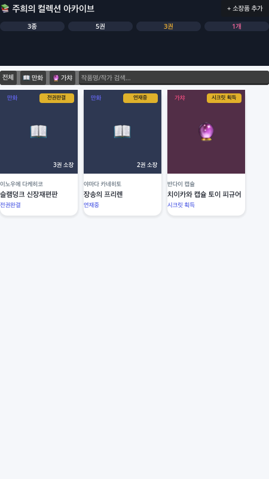

# 📚 Pocket Archive (Game02) — 만화책 & 가챠 컬렉션 보관함

Godot 4.6.2 모바일 기반의 깔끔하고 직관적인 **단행본 권별 소장 및 가챠 피규어 아카이브 앱**입니다.

---

## 📸 실제 구동 스크린샷 (Godot 4.6 렌더링 - Sprint 5)



---

## 🚀 애자일 스프린트 현황

### [Sprint 5] 로컬 JSON 영구 세이브/로드 및 데이터 영속화
- **다꾸러 & 수집러 VOC 반영**:
  - *"내가 열심히 등록한 만화책 권수랑 별점, 가챠 기록들이 앱을 껐다 켜도 안전하게 남아있어야 해요. 파일로 백업할 수 있으면 더 좋아요!"*
- **개발 내역**:
  - `collection_item.gd`에 `to_dict()` 직렬화 메서드 구현
  - `archive_state.gd`에 `save_to_file()` 및 `load_from_file()` 자동 영구 저장/복원 파이프라인 탑재 (`user://archive_data.json`)
  - 신규 등록 및 삭제 시 자동으로 로컬 파일에 즉시 동기화
- **테스트 검증**:
  - `tests/test_persistence.gd` 신규 작성 및 100% PASS 확인
  - `tests/test_main_integration.gd` 100% PASS 확인

### [Sprint 4] 다꾸 스티커 뱃지 시스템 & 웹 표지 로더 유틸리티
- `card_item.tscn`에 우측 상단 `StickerBadge` 스타일박스 추가 (골드 옐로 스티커 룩)
- `web_cover_loader.gd`: 향후 웹 URL 및 로컬 이미지 텍스처 로딩을 위한 ImageTexture 팩토리 유틸리티 구현

---

## ✨ 핵심 기능

1. **상단 컬렉션 대시보드**:
   - 총 소장 작품 종수, 만화 단행본 총 권수, 초판 특전 보유 권수, 가챠 피규어 개수 실시간 집계
2. **원클릭 카테고리 필터 & 실시간 검색**:
   - `전체`, `📖 만화`, `🔮 가챠` 탭 전환
   - 검색창에 단어 입력 시 실시간으로 카드 필터링
3. **2:3 표지 비율 카드 뷰 (`CardItem`)**:
   - 시각적 노이즈를 뺀 화이트 카드, 소장 권수 뱃지, 다꾸 스티커 뱃지, 제목/작가 레이블
4. **권별 독서 다이어리 상세 모달 (`DetailModal`)**:
   - 카드를 터치하면 부드럽게 열리는 팝업
   - 1권~N권 소장 여부(`초판특전` / `소장완료`), 별점(★), 명대사 기록 및 `+ 다음 권 추가`
5. **새 소장품 간편 등록 모달 (`AddModal`)**:
   - 제목, 작가/시리즈명, 카테고리를 입력하고 바로 등록
6. **로컬 JSON 데이터 자동 영구 저장**:
   - `user://archive_data.json`에 실시간 자동 동기화되어 앱 종료 후에도 데이터 영구 보존

---

## 🧪 자동화 테스트 검증 (Headless CI)

```bash
godot --headless --path godot_project -s tests/test_persistence.gd
godot --headless --path godot_project -s tests/test_main_integration.gd
```

```text
--- Running Godot JSON Persistence Tests ---
✓ Test 1: Save to JSON succeeded
✓ Test 2: Load from JSON verified with exact data match
✓ Test 3: Cleaned up test artifacts
--- ALL PERSISTENCE TESTS PASSED (100%) ---
```
