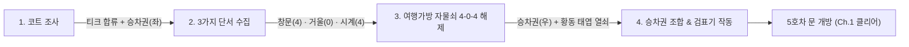

# Chapter 1: 5호차 — 잠든 침대칸 상세 퍼즐 설계

- **목표**: 잠긴 5호차 출구 문을 열고 4호차(식당칸)로 이동하기
- **공간 구조**: 2.5D 횡스크롤 객차 (총 너비 `2200px`, 카메라 좌우 스크롤 이동)
  - **좌측 구역**: 침대, 걸려 있는 오버사이즈 코트, 침대 밑 잠긴 가죽 여행가방
  - **중앙 구역**: 별바다가 보이는 큰 아치형 창문, 작은 원목 테이블(회중시계 & 여행일지), 가스등
  - **우측 구역**: 김이 서린 황동 거울, 5호차 출구 문, 황동 부엉이 검표기

---

## 1. 퍼즐 클리어 플로우 (4단계)

---

## 2. 오브젝트 및 상호작용 명세

| 오브젝트 | 위치 | 초기 상태 | 상호작용 / 퍼즐 내용 | 보상 |
| :--- | :--- | :--- | :--- | :--- |
| **오버사이즈 코트** | 좌측 침대 옆 | 조사 가능 | 클릭 시 주머니에서 황동 태엽 참새 **티크**가 깨어나며 합류 | `승차권 조각(좌)`, 티크 힌트 활성화 |
| **작은 테이블 (회중시계 & 메모)** | 중앙 | 확대 가능 | `04:04`에 멈춘 회중시계와 여행일지 확인. 일지 힌트: *"첫째는 별이 그린 숫자, 둘째는 거울 속 보름달, 셋째는 멈춘 시계의 분침."* | 가방 암호 추리 단서 (세 번째 숫자: **4**) |
| **아치형 밤하늘 창문** | 중앙 | 확대 가능 | 밤하늘의 빛나는 별들이 선으로 이어져 **숫자 `4`** 모양의 별자리를 이룸 | 첫 번째 숫자: **4** |
| **황동 거울** | 우측 | 김 서림 | 확대 팝업에서 거울을 클릭해 김 서림을 닦아내면 보름달 문양의 **숫자 `0`**이 드러남 | 두 번째 숫자: **0** |
| **가죽 여행가방** | 좌측 침대 밑 | 3자리 다이얼 잠금 | 3자리 다이얼을 **`4 - 0 - 4`**로 맞추면 개방 | `승차권 조각(우)`, `황동 태엽 열쇠` |
| **인벤토리 조합** | 하단 UI | 재료 보유 시 | `승차권 조각(좌)` 선택 후 `승차권 조각(우)` 클릭(또는 조합 버튼) | `복원된 승차권 (좌석 404)` |
| **황동 부엉이 검표기** | 우측 문 옆 | 태엽 풀림 | 1) `황동 태엽 열쇠`로 태엽 감기 2) `복원된 승차권` 투입 → 펀칭 완료 | 5호차 출구 문 잠금 해제 |
| **5호차 출구 문** | 우측 끝 | 잠금 | 잠금 해제 후 클릭 시 차장의 안내 방송과 함께 Chapter 1 클리어 | 4호차 이동 연출 |

---

## 3. 티크(Tick) 단계별 동적 힌트 시스템
현재 진행 플래그에 따라 티크가 상황에 맞는 힌트를 제공합니다.
1. **코트 조사 전**: *(티크 미합류 — 침대 옆 코트가 반짝이며 유도)*
2. **가방 열기 전**: *"침대 밑 가방에 자물쇠가 걸려 있네! 테이블 위 일지를 읽어보고, 창문·거울·시계에서 세 숫자를 찾아보자!"*
3. **승차권 조합 전**: *"어라? 승차권 조각이 두 개 모였어! 가방(인벤토리)에서 두 조각을 합쳐볼까?"*
4. **검표기 작동 전**: *"문 옆에 부엉이 모양 검표기가 있어! 먼저 태엽 열쇠로 감아주고, 완성된 승차권을 넣어보자!"*
5. **문 개방 후**: *"문이 열렸어! 자, 4호차로 건너가 보자!"*
