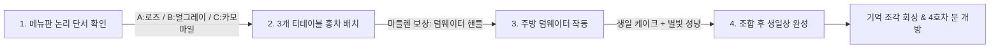

# Chapter 2: 4호차 — 끝없는 티타임의 식당칸 상세 퍼즐 설계

- **목표**: 도자기 인형 요리사 ‘마들렌’을 도와 멈춰버린 생일상을 완성하고, 4호차 출구 문을 열어 3호차(온실·화실칸)로 이동하기
- **공간 구조**: 2.5D 횡스크롤 식당칸 (총 너비 `2200px`)
  - **좌측 구역**: 황동 티 바(찻주전자 선반), 벽면 주문서·메뉴 게시판
  - **중앙 구역**: 별바다가 보이는 2개의 아치형 창문, 하얀 식탁보의 3개 티테이블(A·B·C), **도자기 인형 요리사 ‘마들렌’**, 황동 샹들리에
  - **우측 구역**: 주방 덤웨이터(음식 승강기), 4호차 출구 문

---

## 1. 퍼즐 클리어 플로우 (4단계)

---

## 2. 오브젝트 및 상호작용 명세

| 오브젝트 | 위치 | 상호작용 / 퍼즐 내용 | 보상 |
| :--- | :--- | :--- | :--- |
| **주문서 게시판** | 좌측 벽면 | 레이튼식 논리 추리 메모 확인: - *로즈 티는 C(시계 옆)도 B(중앙)도 아니다.* - *얼그레이는 A(창가)도 C(시계 옆)도 아니다.* - *남은 자리에 카모마일을 놓아라.* | 티테이블 정답 추리 (`A: 로즈`, `B: 얼그레이`, `C: 카모마일`) |
| **황동 티 바** | 좌측 | 3가지 향긋한 홍차(로즈·얼그레이·카모마일)와 찻잔 관찰 | 배경 단서 및 분위기 연출 |
| **3개 티테이블 (A·B·C)** | 중앙 | 확대 모달에서 각 테이블에 맞는 홍차를 선택해 서빙 | 마들렌에게 **`황동 덤웨이터 핸들`** 획득 |
| **도자기 인형 요리사 (마들렌)** | 중앙 | 상황별 대화 + `촛불 켜진 생일 케이크` 전달 시 기억 회상 연출 | 4호차 출구 문 잠금 해제 |
| **주방 덤웨이터** | 우측 | `황동 덤웨이터 핸들` 사용 시 아래 주방에서 음식이 올라옴 | **`생일 케이크`**, **`별빛 성냥`** |
| **인벤토리 조합** | 하단 UI | `생일 케이크` + `별빛 성냥` 조합 | **`촛불 켜진 생일 케이크`** |
| **4호차 출구 문** | 우측 끝 | 잠금 해제 후 클릭 시 Chapter 2 클리어 & 3호차 예고 | Ch.2 클리어 연출 |
